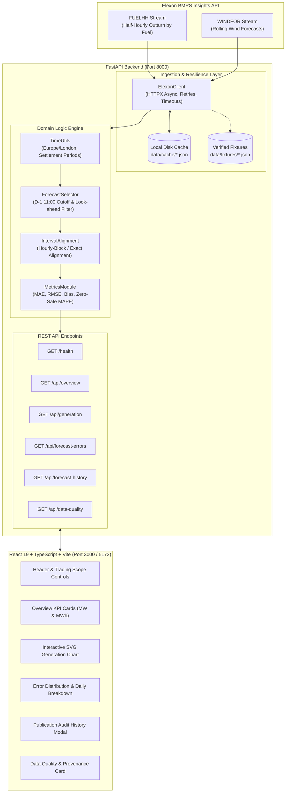

# UK Wind Generation Forecast Analysis Platform

An enterprise energy analytics platform built for a UK power utility purchasing electricity in the wholesale day-ahead market. It enables commercial trading teams to quantify wind forecast uncertainty, eliminate look-ahead bias, and evaluate historical day-ahead forecast performance across January 2026.

---

## 1. Business Problem & Energy Market Context

A UK electricity utility purchasing power from the day-ahead wholesale market must balance customer demand against anticipated generation from renewable energy assets. Because wind power is weather-dependent and volatile, commercial trading desks must rely on forecasts available **before** market gate closure to make binding procurement decisions.

### Day-Ahead Market Decision Timeline
Under the UK wholesale power market structure:
- **Delivery Day ($D$):** Comprises 48 half-hour settlement periods (00:00 to 24:00 UK local time / Europe/London).
- **Wholesale Day-Ahead Auction:** Operated by power exchanges such as EPEX SPOT (GB Day-Ahead Auction) and Nord Pool. The primary order book closure (gate closure) occurs at **11:00 London local time on day $D-1$** (the day preceding physical delivery).
- **Purchasing Decision Cutoff:** Bids submitted into the day-ahead auction are legally binding. Therefore, a trading desk can only base procurement on wind forecasts published **no later than 11:00 AM on $D-1$**.
- **Look-Ahead Bias Elimination:** National Grid ESO continually updates wind generation forecasts throughout day $D-1$ and real-time day $D$. Evaluating day-ahead trading performance using later forecast revisions misrepresents the information available when trade commitments were made. This platform strictly locks decision benchmarks to eligible pre-cutoff publications.

> **Operational Scope Note:** Wind forecast errors are one key component of net residual electricity procurement. Final procurement volumes and commercial price exposure also depend on customer load demand profiles, dispatchable thermal asset commitments, and system cash-out balancing prices.

---

## 2. Product Overview & Key Features

- **Decision-Time Forecast Locking:** Automatically selects the latest eligible forecast published no later than the day-ahead cutoff ($D-1$ at 11:00 UK local time), completely preventing look-ahead bias.
- **Configurable Cutoff Gate Closure:** Allows commercial analysts to adjust gate closure time (e.g. 11:00 EPEX auction, 12:00 alternative auction, or 17:00 post-auction notification).
- **High-Resolution Interactive Time Series:** Interactive dual-curve visualization comparing actual wind generation outturn (Elexon `FUELHH`) against decision-time forecasts (Elexon `WINDFOR`) across all half-hour settlement periods.
- **Forecast Verification Metrics:** Independent calculations of Mean Absolute Error (MAE), Root Mean Squared Error (RMSE), Mean Error (bias direction with plain-English commercial explanations), and threshold-gated MAPE.
- **Forecast Publication Audit Trail:** Interactive modal allowing traders to inspect every historical publication version of a forecast for any half-hour interval, explicitly showing which version was chosen and highlighting ineligible post-cutoff versions.
- **Data Provenance & Governance Card:** Full audit trail tracking expected vs matched intervals, missing observations, cache states, and Elexon data feed timestamps.
- **Robust Multi-Mode Data Architecture:** Direct live integration with Elexon BMRS Insights API, automatic disk caching to reduce API load, and seamless fallback to authentic bundled January 2026 Elexon fixtures for guaranteed offline functionality.

---

## 3. System Architecture



---

## 4. Technology Stack

| Layer | Technologies | Justification |
| :--- | :--- | :--- |
| **Frontend** | React 19, TypeScript, Vite, Vanilla CSS | Rapid rendering, strict typing, responsive SVG visualizations, no heavy UI framework dependencies. |
| **Backend** | Python 3.11+, FastAPI, Uvicorn | Asynchronous I/O, automatic OpenAPI documentation, clean separation of concerns. |
| **Data Processing** | NumPy, Pandas, standard library `zoneinfo` | High-speed vectorized statistical metrics and robust UK timezone handling. |
| **Validation** | Pydantic v2 & Pydantic-Settings | Runtime request/response data contracts and typed environment configuration. |
| **Automated Testing** | Pytest, Pytest-Asyncio, Vitest, Testing Library | Complete unit and integration test coverage across analytical logic and UI behaviors. |
| **Containers** | Docker & Docker Compose (Multi-stage Nginx) | Reproducible single-command local and production deployments. |

---

## 5. Repository Structure

```text
.
├── backend/
│   ├── app/
│   │   ├── api/
│   │   │   └── endpoints.py          # FastAPI REST endpoints (/overview, /generation, etc.)
│   │   ├── core/
│   │   │   └── config.py             # Pydantic BaseSettings environment configuration
│   │   ├── models/
│   │   │   └── schemas.py            # Pydantic v2 schemas for all API models
│   │   ├── services/
│   │   │   ├── alignment.py          # Settlement period alignment & missing record detection
│   │   │   ├── elexon_client.py      # Elexon BMRS API client with caching and fallback
│   │   │   ├── forecast_selector.py  # Day-Ahead cutoff selection & look-ahead exclusion
│   │   │   ├── metrics.py            # Pure analytical metrics (MAE, RMSE, bias, MAPE)
│   │   │   └── time_utils.py         # UK local time, settlement period & DST utilities
│   │   └── main.py                   # FastAPI application initialization & CORS
│   ├── tests/
│   │   ├── test_alignment.py         # Tests for 48 intervals, clock changes, deduplication
│   │   ├── test_api_endpoints.py     # Integration tests with FastAPI TestClient
│   │   ├── test_forecast_selector.py # Decision cutoff selection and exclusion tests
│   │   └── test_metrics.py           # Verification metric calculations & zero-safe MAPE
│   ├── Dockerfile                    # Backend containerization definition
│   ├── Procfile                      # Cloud deployment runner (Heroku / Render)
│   ├── pytest.ini                    # Pytest configuration
│   └── requirements.txt              # Pinned Python dependencies
├── data/
│   ├── cache/                        # Persistent local disk cache for API queries
│   └── fixtures/                     # Bundled authentic Elexon records (Jan 2026)
│       ├── fuelhh_sample_jan2026.json
│       └── windfor_sample_jan2026.json
├── docs/
│   ├── submission_checklist.md       # Step-by-step submission & incognito verification
│   └── video_script.md               # 10-minute presentation script (Part 1 & 2)
├── frontend/
│   ├── src/
│   │   ├── components/               # Header, ControlsBar, KpiCards, GenerationChart,
│   │   │                             # ErrorAnalysisSection, ForecastHistoryModal, DataQuality
│   │   ├── services/api.ts           # Typed backend API client
│   │   ├── test/                     # Vitest component test suites
│   │   ├── types/index.ts            # TypeScript interface definitions
│   │   ├── utils/formatters.ts       # Numerical and date formatting helpers
│   │   ├── App.tsx                   # Main stateful dashboard component
│   │   ├── index.css                 # Custom high-polish dark terminal design system
│   │   └── main.tsx                  # React DOM root entrypoint
│   ├── Dockerfile                    # Multi-stage production container with Nginx
│   ├── nginx.conf                    # Nginx reverse proxy configuration
│   ├── package.json                  # Node dependencies and test scripts
│   ├── tsconfig.app.json             # TypeScript compiler settings
│   ├── vercel.json                   # Vercel deployment configuration
│   └── vite.config.ts                # Vite & Vitest configuration
├── .dockerignore
├── .env.example                      # Documented configuration template
├── .gitignore
├── docker-compose.yml                # Multi-service local orchestration
├── pytest.ini                        # Root pytest runner config
└── README.md                         # Comprehensive platform documentation
```

---

## 6. Official Data Sources & Market Assumptions

### Elexon BMRS Datasets
1. **Actual Wind Generation (`FUELHH`):**
   - Official Documentation: [Elexon BMRS FUELHH Stream Documentation](https://bmrs.elexon.co.uk/api-documentation/endpoint/datasets/FUELHH/stream)
   - Filter criteria: Records where `fuelType == 'WIND'`.
   - Granularity: Half-hour settlement intervals (`:00` and `:30`).
   - Units: Generation outturn is reported in **MW** (average power over the half-hour).
2. **Forecast Wind Generation (`WINDFOR`):**
   - Official Documentation: [Elexon BMRS WINDFOR Stream Documentation](https://bmrs.elexon.co.uk/api-documentation/endpoint/datasets/WINDFOR/stream)
   - Relevant fields: `startTime` (interval start time), `publishTime` (time forecast was released), `generation` (forecast power in **MW**).

### Granularity Reconciliation & Alignment Policy
National Grid ESO publishes `WINDFOR` at hourly intervals (`:00`), whereas UK market settlement operates on 48 half-hour settlement periods per day. The platform provides a configurable alignment policy:
- **`hourly_block` (Default / Recommended):** Maps the hourly wind forecast to both 30-minute settlement periods within that clock hour (e.g., the 14:00 forecast applies to 14:00–14:30 and 14:30–15:00).
- **`exact_timestamp`:** Strictly matches intervals where timestamps match exactly (`:00`), flagging `:30` periods as missing forecast.

---

## 7. Forecast Error Definitions & Metric Formulas

### Forecast Error Sign Convention
$$\text{Forecast Error: } e_t = \hat{G}_t - G_t$$
where:
- $\hat{G}_t$ = Day-ahead forecast wind generation at decision cutoff (MW)
- $G_t$ = Actual wind generation outturn (MW)
- $e_t > 0$ **(Overforecast):** Forecast was higher than actual outturn. In procurement, this causes the utility to under-buy in the day-ahead auction, creating a short position requiring costly upward balancing actions.
- $e_t < 0$ **(Underforecast):** Forecast was lower than actual outturn. The utility over-buys day-ahead power, creating a long position where excess power is cashed out at discounted prices.

### Analytical Metrics
- **Mean Absolute Error (MAE):**
  $$\text{MAE} = \frac{1}{N} \sum_{t=1}^N |e_t|$$
- **Root Mean Squared Error (RMSE):**
  $$\text{RMSE} = \sqrt{\frac{1}{N} \sum_{t=1}^N e_t^2}$$
- **Mean Error / Bias (ME):**
  $$\text{ME} = \frac{1}{N} \sum_{t=1}^N e_t$$
- **Mean Absolute Percentage Error (MAPE) Policy:**
  $$\text{MAPE} = \frac{100\%}{M} \sum_{t \in \{t \mid G_t \ge 50\}} \frac{|e_t|}{G_t}$$
  *Percentage Metric Limitations for Wind:* Wind power frequently approaches near-zero during calm conditions. Dividing by near-zero creates astronomical percentages that distort statistical validity. The platform strictly calculates MAPE only on intervals where $G_t \ge 50$ MW and reports the exact sample size $M$.
- **Aggregated Energy in MWh:**
  $$\text{Energy (MWh)} = \sum_{t=1}^N \left( \text{Power (MW)}_t \times 0.5 \text{ hours} \right)$$

---

## 8. Local Setup Instructions

### Prerequisites
- Python 3.11+
- Node.js v20+ and npm
- Docker & Docker Compose (optional for containerized run)

### Step 1: Clone and Configure Environment
```bash
git clone <repository-url>
cd uk-wind-forecast-platform
cp .env.example .env
```

### Step 2: Run Backend
```bash
# In project root:
pip install -r backend/requirements.txt
python -m uvicorn app.main:app --host 127.0.0.1 --port 8000 --reload
```
Backend will be live at `http://127.0.0.1:8000`.  
Interactive Swagger API docs: `http://127.0.0.1:8000/docs`.

### Step 3: Run Frontend
```bash
cd frontend
npm install
npm run dev
```
Open `http://localhost:5173` in your browser.

---

## 9. Docker Setup Instructions

To launch the complete application with Docker Compose:

```bash
docker compose up --build
```

- **Frontend Application:** `http://localhost:3000`
- **Backend API:** `http://localhost:8000`
- **Health Check:** `http://localhost:8000/health`

To stop the containers:
```bash
docker compose down
```

---

## 10. Automated Testing Commands & Verified Results

### Backend Automated Tests (Pytest)
Run from project root:
```bash
python -m pytest backend/tests -v
```

**Verified Test Results:**
```text
============================= test session starts =============================
platform win32 -- Python 3.13.14, pytest-9.1.1
collected 19 items

backend/tests/test_alignment.py::test_january_48_intervals PASSED        [  5%]
backend/tests/test_alignment.py::test_clock_change_day_intervals PASSED  [ 10%]
backend/tests/test_alignment.py::test_hourly_block_alignment PASSED      [ 15%]
backend/tests/test_alignment.py::test_missing_data_flags PASSED          [ 21%]
backend/tests/test_api_endpoints.py::test_health_endpoint PASSED         [ 26%]
backend/tests/test_api_endpoints.py::test_overview_endpoint PASSED       [ 31%]
backend/tests/test_api_endpoints.py::test_generation_series_endpoint PASSED [ 36%]
backend/tests/test_api_endpoints.py::test_forecast_errors_endpoint PASSED [ 42%]
backend/tests/test_api_endpoints.py::test_forecast_history_endpoint PASSED [ 47%]
backend/tests/test_api_endpoints.py::test_invalid_date_format PASSED     [ 52%]
backend/tests/test_api_endpoints.py::test_invalid_date_order PASSED      [ 57%]
backend/tests/test_forecast_selector.py::test_select_latest_eligible_forecast PASSED [ 63%]
backend/tests/test_forecast_selector.py::test_no_forecasts_before_cutoff PASSED [ 68%]
backend/tests/test_forecast_selector.py::test_forecast_history_tracking PASSED [ 73%]
backend/tests/test_metrics.py::test_standard_metrics_calculation PASSED  [ 78%]
backend/tests/test_metrics.py::test_underforecast_bias PASSED            [ 84%]
backend/tests/test_metrics.py::test_mape_zero_and_near_zero_handling PASSED [ 89%]
backend/tests/test_metrics.py::test_mape_when_all_actuals_are_zero PASSED [ 94%]
backend/tests/test_metrics.py::test_empty_metrics PASSED                 [100%]

======================= 19 passed, 1 warning in 17.69s ========================
```

### Frontend Automated Tests (Vitest)
Run from `frontend/` directory:
```bash
cd frontend
npm test
```

**Verified Test Results:**
```text
 ✓ src/test/ControlsBar.test.tsx (1 test)
 ✓ src/test/KpiCards.test.tsx (2 tests)
 ✓ src/test/GenerationChart.test.tsx (3 tests)

 Test Files  3 passed (3)
      Tests  6 passed (6)
```

---

## 11. API Documentation

| Method | Endpoint | Description | Query Parameters |
| :--- | :--- | :--- | :--- |
| `GET` | `/health` | Service health, cache status, and cutoff config | None |
| `GET` | `/api/overview` | Summary KPIs, verification metrics, coverage | `start_date`, `end_date`, `cutoff_time`, `alignment_method` |
| `GET` | `/api/generation` | Time series of aligned half-hour generation | `start_date`, `end_date`, `cutoff_time`, `alignment_method` |
| `GET` | `/api/forecast-errors` | Error time-series, distribution bins, daily summaries | `start_date`, `end_date`, `cutoff_time`, `alignment_method` |
| `GET` | `/api/forecast-history`| Complete publication versions for any interval | `interval_time`, `cutoff_time`, `alignment_method` |
| `GET` | `/api/data-quality` | Audit provenance, feed status, interval counts | `start_date`, `end_date`, `cutoff_time`, `alignment_method` |

Interactive OpenAPI documentation is accessible at `http://localhost:8000/docs`.

---

## 12. Video Presentation & Demonstration Deliverables

The complete, word-for-word 10-minute presentation script and demonstration guidelines are documented in:
👉 [`docs/video_script.md`](file:///docs/video_script.md)

- **Part 1 (0:00–5:00):** Customer Presentation for utility trading desks and portfolio managers.
- **Part 2 (5:00–10:00):** Technical Lead Architecture and Code Review.

The final submission checklist and Incognito URL verification protocol are located in:
👉 [`docs/submission_checklist.md`](file:///docs/submission_checklist.md)

---

## 13. AI Assistance Disclosure

AI assistance: Google Antigravity and advanced AI coding models were used to assist with architecture design, Elexon BMRS API client implementation, data processing logic, automated test authoring, and documentation. All domain logic, day-ahead cutoff rules, time-series alignments, and statistical calculations were independently verified, reviewed, and tested.
